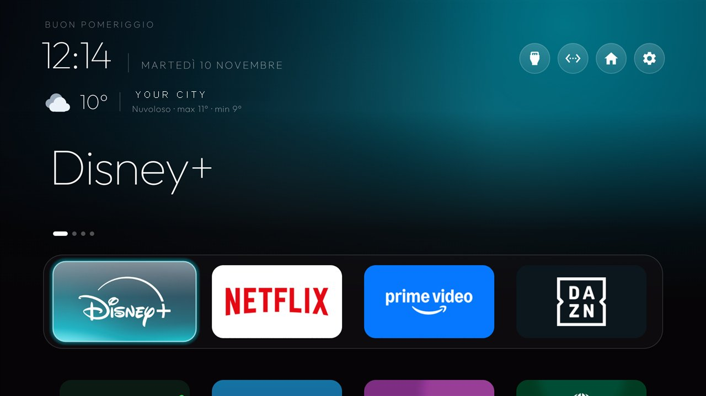
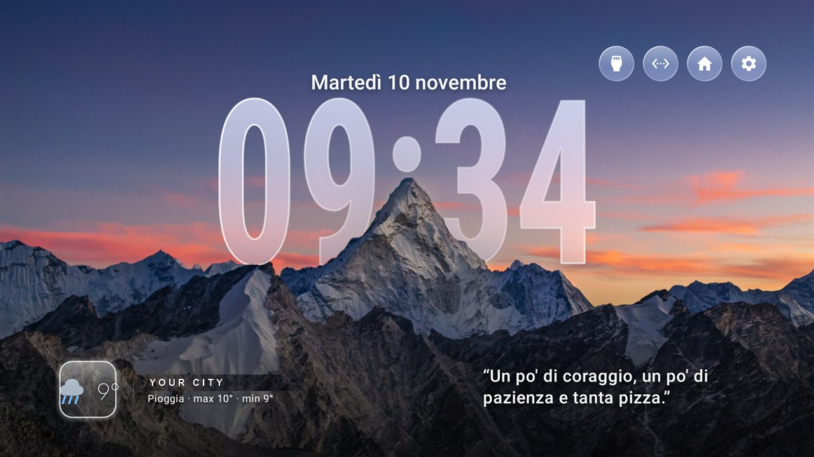
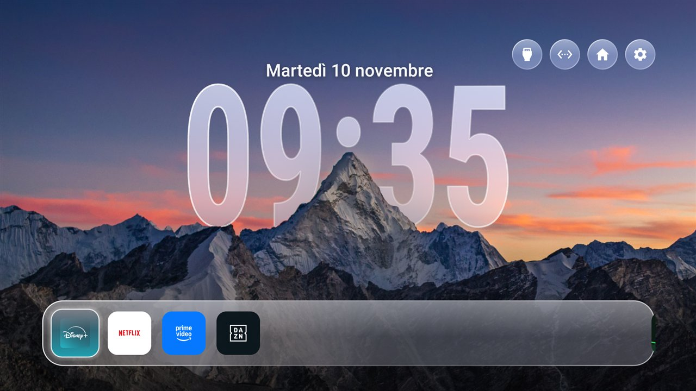
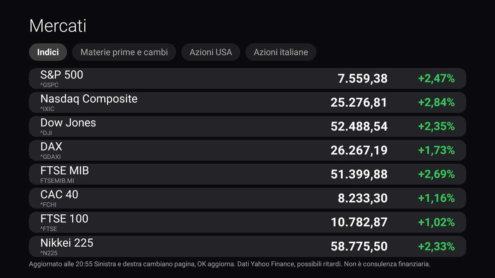

# android-tv-home-plus

A light, Apple-TV-style home screen for Android TV, with **weather** and more settings you can change
from the remote. It is a fork of the launcher in
[Gathin23/cleanyourtv](https://github.com/Gathin23/cleanyourtv) (MIT), built to stay fast on old TVs
with about 1–2 GB of RAM.

> **Tested only on one TV:** Philips 55POS9002/12 (TP Vision TPM171E, device `PH7M_EU_5596`,
> Android TV 8.0.0, 1.9 GB RAM). The additions here use plain Android APIs and do not depend on the
> model, and the upstream launcher is reported to work on many other Android TV / Google TV sets, but
> I have **not** verified any other model. Treat other TVs as untested and keep a way back to the stock
> launcher (see [Going back](#going-back)).

## What this adds to the upstream launcher

- **Weather next to the clock**, from [Open-Meteo](https://open-meteo.com/) (free, no account, no API key):
  an icon drawn in code (no images), the temperature, the place, the day's maximum and minimum.
- **More settings on the TV** (Launcher settings, with the remote): the weather **on or off** (on by default),
  the weather city (37 Italian cities), cinematic home on or off, and the dynamic sky (off, light, strong). Choices made on the TV
  win over a theme until you pick *Follow theme*.
- **Any place** through a theme: `weather_city` takes a city name, `"lat,lon"` or `"lat,lon,Name"`; `weather_enabled: false` hides the weather.
- **A short motivational line under the clock**, off until you turn it on (Launcher settings, or `"quotes"` in a
  theme): `local` shows one from a list built into the launcher (about 70 Italian and 40 English, in the TV's
  language where there is one, no network), `online` shows ZenQuotes' English quote of the day with its credit
  (one request a day; the list shows while it loads or if the answer does not suit).
- **A small round Launcher settings icon** beside the TV Settings button (`launcher_settings_icon`, on by default),
  so the settings are one press away without a long press.
- **A second theme, "Mountain"**, chosen in Launcher settings (*Theme*: *Lite*, the default, or *Mountain*) or with `"clock_look": true` in a theme, see
  [`themes/clock-look`](themes/clock-look/config.json): a phone lock screen on the TV, with a photograph (CC BY-SA 4.0, credited in
  [CREDITS](themes/clock-look/CREDITS.md)), a huge glass clock partly *behind* the mountain, the date above it, the weather and
  a quote at the bottom and round liquid-glass buttons. Press Down and the docks of square icon cards come up, one each for streaming, games and everything else; Up or Back puts
  them away. The glass is drawn from a tiny blurred copy of the picture, not blurred live. It costs a little more than Lite:
  see [Performance](#performance-lite-and-mountain).
- **The name of a focused icon-only top button** appears above the row.
- **An add-on for the markets**, [`addons/stocks`](addons/stocks/): indices, commodities, currencies and stocks on four
  full-screen pages, with a card on Home. A separate app, so the launcher does not depend on it.
- A ready theme for the Philips above: [`themes/philips-tpm171e`](themes/philips-tpm171e/config.json).
- Italian strings for the new rows.

### Screenshots

Taken on the Philips 55POS9002/12 (the weather place is replaced by "YOUR CITY" in the first two pictures).

| Lite (the default theme) | Mountain | Mountain: Down brings the dock up |
|---|---|---|
|  |  |  |

The Markets add-on:


### Cost on the TV

Everything is built so that it costs almost nothing:

- The weather runs **only while Home is on screen**: one HTTPS request at most every 30 minutes (5 minutes
  after a failure), on one short-lived thread, with the last answer cached. No service, no alarm, no timer
  in the background.
- The icon is a few shapes on a canvas, redrawn only when the weather changes.
- The weather is on by default, but **nothing is requested until a city is chosen**: with no city, a short hint
  under the clock says where to pick one. With the weather switched off, the launcher makes no network request at all.
- On the Philips above the launcher uses about 100 MB of RAM with weather, cinematic home and sky on.

### Performance: Lite and Mountain

**Mountain costs more than Lite.** It keeps a decoded photograph in memory, draws a glass clock and a copy of the
mountains over it, and starts a little slower. Measured on the Philips above (Android 8.0, about 1.9 GB of RAM), the same
build, weather on, quotes off, `reduced_motion` on, one session of measurements, so read them as an indication and not
as a benchmark:

| | Lite | Mountain |
|---|---|---|
| Cold start (4 starts, ms) | 978, 974, 967, 1036 (average **989**) | 1173, 1120, 1155, 1133 (average **1145**) |
| Memory of the launcher, PSS (`dumpsys meminfo`) | **22.9 MB** | **37.9 MB** |
| of which native heap | 14.9 MB | 30.5 MB |
| Resident memory (`top`) | 81 MB | 105 MB |
| Free RAM of the whole TV (`dumpsys meminfo`) | 566 MB | 546 MB |
| CPU while Home sits idle (`top`, 15 s) | 0.0 % | 0.0 % |
| Smoothness moving through the icons (`dumpsys gfxinfo`, 12 key presses) | 33 frames, 51.5 % janky, median 20 ms, 90th percentile 40 ms | 52 frames, 40.4 % janky, median 15 ms, 90th percentile 40 ms |

What that shows: Mountain used **about 15 MB more memory** (the decoded photograph, the copy of the mountains and
the blurred copy of the picture) and took **about 0.15 s longer to start**. At rest neither used measurable CPU. I could
not tell the two apart on smoothness: both have a lot of janky frames on this TV's GPU, and an earlier Lite run gave
40 % janky with a 90th percentile of 25 ms, so the difference between the two is within the run-to-run noise of such
small samples (the two runs also did slightly different key sequences, because Mountain starts with Down).

The figures were taken before the dock was split into its three groups (streaming, games, the rest), which only adds a few more glass bands to draw. Not measured: memory while an app is open and Home is in the background (the photograph is released when Home's view
goes away, which may not happen right away), and any other TV. On a TV with little free memory, stay on **Lite**: it is
the default, and the choice is *Launcher settings → Theme*.
### Privacy and permissions

The upstream launcher had no `INTERNET` permission. This fork adds it **only for the weather and, if you pick
Online, the daily quote**. For the weather the only thing sent is the coordinates of the chosen place to
`api.open-meteo.com` (and, for a city name that is not one of the presets, the name to
`geocoding-api.open-meteo.com`, once); for the quote, a plain request to `zenquotes.io` once a day, with nothing
about you or the TV. With the weather off and the quotes off or on List, the launcher makes no request at all. The weather needs no account, no
identifier and no location permission: the place is the one you choose, not one read from the TV. (The
upstream launcher separately asks for location access, only to be able to show the Wi-Fi network name.)

## Build

You need a JDK 17 and the Android SDK (platform 34, build-tools 34.0.0). From `launcher/`:

```sh
./gradlew assembleRelease        # Windows: gradlew.bat assembleRelease
```

The APK is `launcher/app/build/outputs/apk/release/app-release.apk`. It is signed with the debug key, so it is
meant for sideloading over ADB, not for a store. The package name is still `com.gathin.tvhome`.

## Install

Turn on USB debugging (and network ADB) on the TV, then:

```sh
adb connect <tv-ip>:5555
adb install -r launcher/app/build/outputs/apk/release/app-release.apk
adb shell cmd package set-home-activity --user 0 com.gathin.tvhome/.MainActivity
```

Press Home to check that it opened. `launcher/build-and-install.sh` (or `.ps1` on Windows) does the same
and can also disable the stock launcher; **it does that only if you let it**, and you should not unless
you can still reach the TV another way.

Then choose the look and the weather:

```sh
TV_HOST=<tv-ip> tools/theme.sh themes/philips-tpm171e      # Philips theme, or any other theme
```

or use *Launcher settings* from the Settings pill on the Home screen. To set a place for the weather in a
theme, add `"weather_city": "Bologna"` (or `"44.50,11.34,Bologna"`) to its `config.json`.

### Going back

Disabling the stock launcher is optional. With it left alone, you can return to it by disabling or uninstalling
this one (`adb shell pm uninstall --user 0 com.gathin.tvhome`). Android then forgets the default home and asks
which one to use: pick the stock one with *Always*.

## Credits and licence

MIT, see [LICENSE](LICENSE). The launcher is by **Gathin** ([cleanyourtv](https://github.com/Gathin23/cleanyourtv),
launcher 3.4, commit `294d3d5`); the weather, the extra settings and this packaging are additions on top of that code. The
Outfit font keeps its own licence (`launcher/FONT-LICENSE-OFL.txt`). Weather data by
[Open-Meteo.com](https://open-meteo.com/) (CC BY 4.0; free for non-commercial use).

Not affiliated with Philips, Google, Netflix or any other brand named here. Use at your own risk: it changes
the home screen of a device, so keep a way to reach the TV (and its settings) before you try it.

---

## Italiano

Una home leggera in stile Apple TV per Android TV, con **meteo** e altre impostazioni modificabili dal
telecomando. È un fork del launcher di [Gathin23/cleanyourtv](https://github.com/Gathin23/cleanyourtv) (MIT),
pensato per restare fluido su TV vecchie con 1–2 GB di RAM.

**Provato solo su una TV:** Philips 55POS9002/12 (TPM171E, Android TV 8.0.0, 1,9 GB di RAM). Le aggiunte non
dipendono dal modello, ma **non ho verificato altre TV**: considerale non testate e tieni sempre una via per
tornare al launcher originale.

- **Meteo** accanto all'orologio, da Open-Meteo (gratuito, senza account né chiave): icona, temperatura,
  località, massima e minima.
- **Impostazioni sulla TV**: meteo acceso o spento (acceso di default), città del meteo, home cinematografica,
  cielo dinamico, frasi motivazionali (spente di default: elenco italiano incluso, oppure una frase inglese al
  giorno da ZenQuotes).
- **Tema «Mountain»** (Impostazioni launcher → Tema; il predefinito è *Lite*; oppure `"clock_look": true` in un tema): una lock screen sulla TV, con foto del tramonto (CC BY-SA 4.0, vedi [CREDITS](themes/clock-look/CREDITS.md)), orologio di vetro in parte *dietro* la montagna, data sopra, meteo e frase in basso e pulsanti rotondi «liquid glass». Premendo Giù salgono le dock con le icone quadrate, una per lo streaming, una per i giochi e una per tutto il resto; Su o Indietro le rimettono via. Costa un po' più di Lite: sulla Philips circa 15 MB di memoria in più e circa 0,15 s di avvio in più (misure nella sezione *Performance* sopra; sul resto, CPU a riposo e fluidità, non ho visto differenze apprezzabili).
- **Icona rotonda** per le impostazioni del launcher accanto a quella delle impostazioni TV.
- **Add-on Mercati** ([`addons/stocks`](addons/stocks/)): indici, materie prime, cambi e azioni (USA e italiane) su
  quattro pagine a schermo intero, con una card nella home. I dati arrivano da Yahoo Finance, possono essere in
  ritardo e non sono consulenza finanziaria.
- Funziona solo mentre la home è visibile: al massimo una richiesta ogni 30 minuti, nessun servizio in
  background. Il meteo è acceso di default, ma **non fa nessuna richiesta finché non scegli una città** (sotto
  l'orologio compare un breve suggerimento). Con il meteo spento non fa nessuna richiesta di rete.
- Rispetto all'originale aggiunge il permesso `INTERNET`, usato solo per il meteo; viene inviata soltanto la
  posizione (coordinate) della città scelta.

Per compilare e installare vedi le sezioni *Build* e *Install* sopra. Il tema
[`themes/philips-tpm171e`](themes/philips-tpm171e/config.json) contiene le impostazioni usate sulla Philips
(dock Netflix / Disney+ / Prime Video, Live TV `org.droidtv.playtv`, movimento ridotto).
